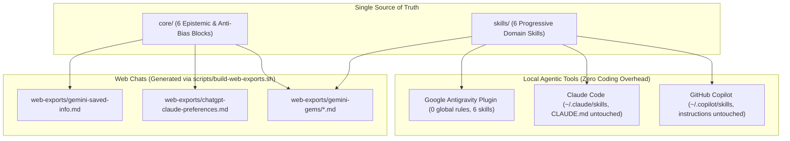

# Critical Thinking & General Analysis Suite (`antigravity-critical-thinking-pack`)

A modular, anti-bias reasoning and critical-analysis pack designed for **non-coding** workflows across **Google Antigravity**, **Anthropic Claude Code**, **GitHub Copilot**, and **Web Chats** (**Google Gemini Saved Info / Gems**, **Claude Web**, **ChatGPT**).

Built to coexist with zero conflict and **zero token overhead during coding** alongside [`antigravity-sdlc-pack`](https://github.com/enielrodriguez/antigravity-sdlc-pack).

---

## 🏛 Architecture & Design Principles



### Key Architectural Decisions
- **Zero Global `rules/` in Antigravity**: Ships progressive `skills/` only, so enabling this plugin adds **0 tokens** to coding sessions and never duplicates or clashes with `antigravity-sdlc-pack/rules/AGENTS.md` or `~/.claude/CLAUDE.md`.
- **Analysis Before Verdict (Anti-Anchoring)**: Complex, high-stakes decisions analyze evidence, trade-offs, risks, and the strongest counter-argument *before* committing to a conclusion—preventing early-token autoregressive confirmation bias.
- **Dynamic Jurisdiction Detection (Anti-U.S.-Default)**: Never silently assumes U.S. law, currency, or healthcare norms; infers country and regional competences from context and explicitly asks when jurisdiction materially changes the answer.
- **Structural Materialist Lens + Uncompromising Empirical Rigor**: Rejects RLHF false-balance (*both-sidesism*) and "view-from-nowhere" status-quo orthodoxy, pairing a structural, materialist distributional lens (wages, housing, public services, living standards) with strict primary-source verification.

---

## 📦 What's Included

### 1. Progressive Domain Skills (`skills/`)
All skills use progressive disclosure (0 token overhead until triggered):

| Skill | Trigger Examples | What It Does |
| :--- | :--- | :--- |
| `critical-socioeconomic-audit` | *"Audit this political interview"* / *"Verify this economic claim"* | Structural, materialist distributional audit paired with primary sources, plural economic frameworks (Marxian political economy, Post-Keynesian/MMT, institutional, ecological), Double-Threshold evasion/fallacy checks, and say-vs-do contradictions. |
| `decision-council` | *"Convene a council on buying vs. renting"* / *"Debate this career move"* | Multi-perspective adversarial council (*Strategist*, *Pragmatist*, *Skeptic / Red Team*) via parallel read-only subagents (or sequential fallback) producing a Chairman Verdict + verbatim Minority Report. |
| `science-and-health-check` | *"Is there real evidence for X?"* / *"Audit this medical claim"* | Evaluates medical, nutritional, psychological, and scientific claims using strict evidence hierarchy, absolute vs. relative risk, real mechanisms, and bias checks—zero pseudoscience or pop-science. |
| `consumer-and-finance-check` | *"Evaluate this mortgage offer"* / *"Compare these cars"* | Total Cost of Ownership (TCO), broker/sales incentive audit, primary contract terms over marketing spin, and boring-baseline comparison. |
| `legal-and-bureaucratic-guide` | *"What are my tenancy/labor rights here?"* / *"How does this tax/residency process work?"* | Statute-grounded legal and administrative guidance respecting national + regional competences, hard statutory deadlines, administrative reality, and clear triage for licensed counsel. |
| `formal-writing-and-career` | *"Review my CV"* / *"Draft a formal complaint/email"* | High-credibility formal writing with strict anti-inflation (zero invented metrics), opaque proprietary entity handling, and zero AI clichés. |

### 2. Web Chat Core Blocks (`core/` → `web-exports/`)
Ready-to-paste files compiled automatically from `core/` + `skills/`:
- [`web-exports/gemini-saved-info.md`](web-exports/gemini-saved-info.md): 6 atomic blocks ready for **https://gemini.google.com/saved-info**.
- [`web-exports/chatgpt-claude-preferences.md`](web-exports/chatgpt-claude-preferences.md): Full profile for **Claude Web Preferences** + compact `≤ 1,500`-char profile for **ChatGPT Custom Instructions**.
- [`web-exports/gemini-gems/`](web-exports/gemini-gems/): 6 standalone prompts ready for **Google Gemini Gems**, **Claude Projects**, or **Custom GPTs**.

---

## 🚀 Installation & Usage

### 1. Local Agentic Tools (Antigravity + Claude Code + GitHub Copilot)
Auto-detects installed platforms, registers the Antigravity plugin, and deploys skills surgically without touching `CLAUDE.md` or `copilot-instructions.md`:

**On Linux / macOS / WSL:**
```bash
git clone https://github.com/enielrodriguez/antigravity-critical-thinking-pack.git
cd antigravity-critical-thinking-pack
./scripts/sync-global-platforms.sh
```

**On Windows (PowerShell):**
```powershell
git clone https://github.com/enielrodriguez/antigravity-critical-thinking-pack.git
cd antigravity-critical-thinking-pack
.\scripts\sync-global-platforms.ps1
```

Options: `-a`/`--all`, `--antigravity`, `--claude`, `--copilot`.

### 2. Web Chats (Gemini, Claude Web, ChatGPT)
No installation required—copy directly from [`web-exports/`](web-exports/).
If you modify `core/` or `skills/`, regenerate all web exports cleanly with:

```bash
./scripts/build-web-exports.sh
```

### 3. Validation & Plugin Management
```bash
# Verify plugin manifest & skill schemas:
agy plugin validate ~/.gemini/config/plugins/antigravity-critical-thinking-pack

# Toggle without uninstalling:
agy plugin disable antigravity-critical-thinking-pack
agy plugin enable antigravity-critical-thinking-pack
```

---

## 📄 License

Apache 2.0
